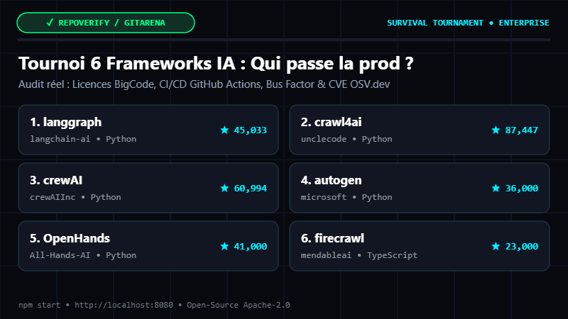

# RepoVerify / GitArena

[](https://github.com/origguard/gitArena-repoverify/actions/workflows/ci.yml)
[](LICENSE)
[](https://nodejs.org/)

**Moteur d'Inspection Chirurgicale, Due-Diligence Open-Source, Arène ELO & Serveur MCP pour dépôts GitHub.**

> **100 % Node.js ESM natif** • **Zéro dépendance NPM externe** • **SQLite WAL + FTS5 sub-milliseconde** • **Audit Supply-Chain OSV.dev & CI/CD en direct**



---

## 🎬 Démos, Duels & Tournois Vidéo (Prêts pour Réseaux)

| Format | Comparatif | Vidéo MP4 (9:16) | Ressources Associées |
| :--- | :--- | :--- | :--- |
| **🏆 Tournoi (6 repos)** | **LangGraph vs CrewAI vs AutoGen vs Crawl4AI vs Firecrawl vs OpenHands** | [▶ Voir la vidéo (26s)](videos/05-tournoi-6-frameworks-ia.mp4) | [📕 Carrousel PDF](videos/05-tournoi-6-frameworks-ia-carousel.pdf) • [📝 Post FR/EN](videos/05-tournoi-6-frameworks-ia-post.md) |
| **⚔️ Duel 1 vs 1** | **Crawl4AI (`Apache-2.0`) vs Firecrawl (`AGPL-3.0`)** | [▶ Voir la vidéo (22s)](videos/01-crawl4ai-vs-firecrawl.mp4) | [📝 Post FR/EN](videos/01-crawl4ai-vs-firecrawl-post.md) |
| **⚔️ Duel 1 vs 1** | **LangGraph vs CrewAI** *(Agents IA)* | [▶ Voir la vidéo (22s)](videos/02-langgraph-vs-crewai.mp4) | [📝 Post FR/EN](videos/02-langgraph-vs-crewai-post.md) |
| **⚔️ Duel 1 vs 1** | **vLLM vs Ollama** *(Inférence LLM)* | [▶ Voir la vidéo (22s)](videos/03-vllm-vs-ollama.mp4) | [📝 Post FR/EN](videos/03-vllm-vs-ollama-post.md) |
| **⚔️ Duel 1 vs 1** | **Qdrant vs Chroma** *(Bases Vectorielles)* | [▶ Voir la vidéo (22s)](videos/04-qdrant-vs-chroma.mp4) | [📝 Post FR/EN](videos/04-qdrant-vs-chroma-post.md) |

> Générez vos propres vidéos en 1 commande : `npm run video -- ownerA/repoA ownerB/repoB` ou `npm run tournament-video`

---

## Pourquoi RepoVerify / GitArena ?

Sur GitHub, le nombre d'étoiles (*star vanity metrics*) ne prouve ni la fiabilité, ni la maintenabilité, ni la conformité légale d'un dépôt. **RepoVerify / GitArena** remplace les vérifications manuelles par un cockpit souverain :

1. **Inspection Chirurgicale & CI/CD Réelle** : vérifie l'activité réelle, les derniers runs **GitHub Actions**, l'indexation **Just-In-Time (JIT)** de n'importe quel dépôt public (`owner/repo`, HTTPS ou SSH) et génère des quittances signées SHA-256.
2. **Audit Juridique BigCode / The Stack v2** : contrôle les licences permissives (`MIT`, `Apache-2.0`, `BSD`, `ISC`, `0BSD`, `Unlicense`) pour éviter toute contamination virale *copyleft* en production ou lors de l'entraînement de modèles d'IA.
3. **Code Intelligence & Supply-Chain (OSV.dev)** : analyse sans clonage via **GitIngest** (avec fallback **GitHub Trees API**), extrait les dépendances (`npm`, `pip`, `Cargo.toml`, `go.mod`), détecte les lockfiles et scanne les CVE connues via **OSV.dev**.
4. **Sandbox Docker Isolé (`Exit Code 0`)** : clone en `--depth 1` et exécute la suite de tests dans un conteneur isolé (`--network=none --memory=1024m --cpus=1 --pids-limit=64`), avec persistance dans `harness_runs`.
5. **Arène & Comparateur ELO** : confrontez deux projets côte-à-côte et arbitrez le classement ELO ($K=32$) avec persistance dans `arena_duels`.
6. **Radar Tactique God's Eye & PixelRAG** : cartographie vectorielle SVG des architectures et projection spatiale par grappes technologiques.
7. **Serveur MCP Natif (`stdio` JSON-RPC 2.0)** : connectez directement vos assistants de code (Antigravity, Cursor, Claude Code) pour auditer les bibliothèques avant de les installer.

---

## Démarrage Rapide (3 Commandes)

**Prérequis :** Node.js `>= 22.0.0` (testé sur Node.js `24.x`, module natif `node:sqlite`).

```bash
# 1. Initialiser et peupler la base SQLite WAL + FTS5
npm run seed

# 2. Exécuter le harnais de vérification E2E complet
npm test

# 3. Lancer l'interface web et l'API REST (http://localhost:8080)
npm start
```

*(Optionnel)* Copiez `.env.example` vers `.env` et renseignez `GITHUB_TOKEN` pour passer de 60 à 5 000 requêtes/heure sur l'API GitHub.

---

## Utilisation Avancée

### 1. Pipeline d'Ingestion Hyperscale (`npm run ingest`)
Peuplez la base à partir de listes SSH ou directement en moissonnant l'API GitHub Search :

```bash
# Moissonner des dépôts réels depuis GitHub (ex: Python, >= 1000 stars, licences permissives)
node src/db/bulk-ingestor.mjs --harvest --pages 5 --min-stars 1000 --lang Python --permissive

# Importer un fichier de URLs SSH (.txt ou .md) en transaction SQLite WAL
node src/db/bulk-ingestor.mjs --file pack_10000_depots_github_ssh/top_depots_ssh_urls.txt
```

### 2. Vérification Sandbox Isolée (`npm run verify`)
Exécute les tests réels d'un dépôt dans un conteneur Docker sans accès réseau (`--network=none`) :

```bash
node src/engines/sandbox-runner.mjs fastapi/fastapi
```

### 3. PR Guard CI & Firewall Comportemental (`npm run guard`)
Bloque automatiquement les dépendances douteuses (`DENY` / `BLOCK_SUSPICIOUS`) dans vos Pull Requests ou en local avant exécution (`preinstall`, `curl | bash`, exfiltration `.ssh`/`.aws`, obfuscation base64/eval) et génère une attestation signée Ed25519 :

```bash
# Audit local hors-ligne avec profil entreprise
npm run guard -- . --offline --profile=enterprise
```

Modèle prêt à l'emploi pour GitHub Actions : [pr-guard-template.yml](.github/workflows/pr-guard-template.yml).

### 4. Intégration MCP dans votre IDE / Agent IA
Ajoutez la configuration suivante dans votre client MCP (Antigravity, Cursor, Claude Desktop) :

```json
{
  "mcpServers": {
    "repoverify": {
      "command": "node",
      "args": ["/chemin/absolu/vers/src/mcp/mcp-server.mjs"]
    }
  }
}
```

Outils MCP exposés (6 outils) : `search_repos`, `inspect_repo`, `get_codeintel`, `compare_repos`, `run_tournament`, `gatekeep_install` (porte d'autorisation Ed25519 avant `npm install` / `pip install` / `git clone`).

---

## Architecture du Projet

```text
├── benchmarks/            # Rapports de tournois publics téléchargeables (Markdown, JSON, PDF)
├── docs/                  # Spécifications d'architecture (01-PRD à 08-VERIFICATION-HARNESS)
├── src/
│   ├── db/                # Schéma SQLite WAL/FTS5 (14 tables), Seeder & Bulk Ingestor
│   ├── engines/           # AI Scoring, ELO, Behavioral Firewall, Trust Ed25519, PR Guard, Benchmarks, Open-Core Licensing, OSV, Sandbox
│   ├── mcp/               # Serveur Model Context Protocol (stdio JSON-RPC 2.0 — 6 outils dont gatekeep_install)
│   ├── public/            # SPA Vanilla JS/CSS (Inspecteur, Arène & Tournoi, Radar, Trust & Benchmarks, Explorateur)
│   ├── server/            # Serveur HTTP souverain, auth Open-Core API Key, anti-traversal et contrôleurs REST
│   ├── studio/            # Studio Vidéo MP4, GIF animé, Carrousels PDF LinkedIn & Benchmark Publisher
│   └── workflows/         # Moteur d'automatisation TCA avec journalisation SHA-256
├── tests/                 # Harnais de vérification E2E complet (19 tests, process.exit(0))
├── videos/                # Vidéos de duels & tournois 9:16 + carrousels prêts pour les réseaux
└── .github/workflows/     # Pipeline CI, PR Guard Template & actualisation hebdomadaire des benchmarks
```

---

## 📊 Benchmarks & Rapports Publics Téléchargeables

Consultez et téléchargez directement nos tournois multi-dépôts actualisés (**Markdown**, **JSON**, **PDF 5 slides**) dans **[benchmarks/README.md](benchmarks/README.md)** :

- **[Frameworks d'Agents IA (Entreprise)](benchmarks/agents-ia-enterprise.md)** ([PDF](benchmarks/agents-ia-enterprise.pdf) • [JSON](benchmarks/agents-ia-enterprise.json))
- **[Scraping Web & Browser Agents IA](benchmarks/scraping-web-automation.md)** ([PDF](benchmarks/scraping-web-automation.pdf) • [JSON](benchmarks/scraping-web-automation.json))
- **[Serving & Inférence LLM Locale](benchmarks/llm-serving-inference.md)** ([PDF](benchmarks/llm-serving-inference.pdf) • [JSON](benchmarks/llm-serving-inference.json))
- **[Bases Vectorielles & RAG (BigCode)](benchmarks/vector-databases-rag.md)** ([PDF](benchmarks/vector-databases-rag.pdf) • [JSON](benchmarks/vector-databases-rag.json))

Pour régénérer tous les rapports en local : `npm run benchmarks`

---

## Licence

Distribué sous licence **Apache-2.0**. Voir [LICENSE](LICENSE) pour plus d'informations.
