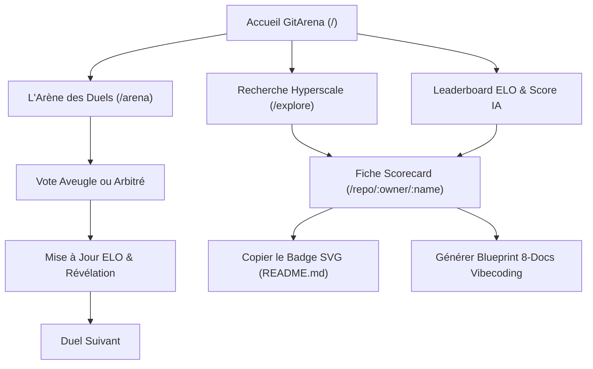

# 03-APPFLOW : Flux Applicatif & Parcours Utilisateur — GitArena

## 1. Table des Routes Publiques & API

| Route | Type | Description Fonctionnelle |
| :--- | :---: | :--- |
| `GET /` | Vue SPA | Dashboard d'accueil : Duel en vedette, Top 10 ELO, explorateur de recherche. |
| `GET /arena` | Vue SPA | Arène interactive de duel en direct (mode aveugle ou sélection manuelle). |
| `GET /explore` | Vue SPA | Explorateur hyperscale avec filtres par langage, licence, score et tri. |
| `GET /repo/:owner/:name` | Vue SPA | Fiche scorecard complète d'un dépôt avec benchmarks et générateur 8 docs. |
| `GET /api/repos` | API REST | Recherche et pagination des dépôts (paramètres: `q`, `lang`, `license`, `limit`, `offset`). |
| `GET /api/arena/duel` | API REST | Génère ou récupère une confrontation de 2 dépôts équilibrés par rang ELO. |
| `POST /api/arena/vote` | API REST | Enregistre le vote de duel, met à jour le classement ELO des deux dépôts et renvoie les nouveaux scores. |
| `GET /api/badge/:owner/:name` | API REST | Génère dynamiquement le badge vectoriel SVG (`Content-Type: image/svg+xml`). |
| `GET /api/scaffold/:owner/:name`| API REST | Génère le blueprint d'architecture Vibecoding 8-docs pour le dépôt ciblé. |
| `GET /api/stats` | API REST | Métriques globales du cluster : dépôts indexés, duels disputés, tests exécutés. |

---

## 2. Parcours Utilisateur (User Journeys)

---

## 3. Gestion Systématique des 4 États Obligatoires par Écran

### Vue 1 : L'Arène des Duels (`/arena`)
1. **Chargement (Loading State)** : Affichage de squelettes animés en pulsation (`skeleton-card`) pour les deux combattants et le terminal de confrontation.
2. **État vide (Empty State)** : Message « Aucun duel actif dans cette catégorie » avec bouton CTA pour sélectionner 2 dépôts personnalisés dans le catalogue.
3. **État d'erreur (Error State)** : Bannière rouge avec code d'erreur (`500` / `404`), cause technique explicite et bouton « Recharger un autre duel ».
4. **État rempli (Populated State)** : Affichage des deux cartes de dépôts (anonymisées en mode aveugle), console de logs de test temps réel, boutons de vote « A gagne », « B gagne », ou « Match Nul », et animation de bascule ELO post-vote.

### Vue 2 : L'Explorateur Hyperscale (`/explore`)
1. **Chargement (Loading State)** : 10 lignes de squelettes avec barres de chargement shimmer.
2. **État vide (Empty State)** : « Aucun dépôt ne correspond à vos filtres » avec réinitialisation en 1 clic des critères de recherche.
3. **État d'erreur (Error State)** : Message d'interruption réseau avec bouton « Relancer la requête ».
4. **État rempli (Populated State)** : Grille de 20 résultats par page avec badges de score IA, étoiles, forks, licences vérifiées, pagination fluide et temps d'exécution affiché en millisecondes.

### Vue 3 : La Fiche Scorecard (`/repo/:owner/:name`)
1. **Chargement (Loading State)** : Structure squelette de la scorecard avec conteneurs de graphiques en gris neutre.
2. **État vide (Empty State)** : Dépôt introuvable avec proposition des 5 projets les plus proches dans la même catégorie.
3. **État d'erreur (Error State)** : Alerte d'échec de chargement des métriques avec conservation des données en cache.
4. **État rempli (Populated State)** : Score global /100, radar des 4 métriques, aperçu en direct du badge SVG avec code Markdown prêt à copier, rapport de test de sortie `Exit Code: 0`, et bouton d'export VibeCoding.
