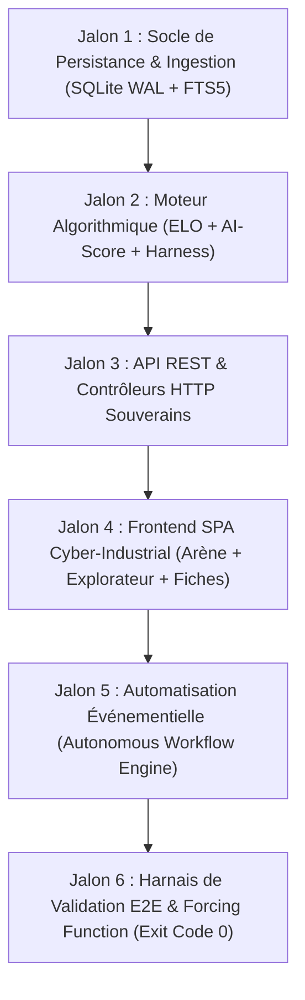

# 06-IMPLEMENTATION-PLAN : Plan d'Implémentation Séquentiel & DAG — GitArena

## 1. Graphe d'Exécution DAG des Jalons

---

## 2. Découpage Détaillé des Jalons Atomiques

### Jalon 1 : Socle de Persistance & Ingestion Réelle
- Création du schéma SQLite avec tables `repositories`, `repositories_fts`, `arena_duels`, `harness_runs`.
- Développement de `database.mjs` exploitant `node:sqlite` natif en mode WAL.
- Développement du `seeder.mjs` ingérant :
  1. Les 200 dépôts critiques d'agents et IA issus de `200 depots gitub.txt`.
  2. L'échantillon des 10 000 dépôts qualifiés issus de `10000_depots_github_ia.md` et `1000000_depots_github_godmod_ia.md`.
- **Validation du Jalon** : Requête SQL confirmant l'insertion et l'indexation FTS5 des dépôts.

### Jalon 2 : Moteurs d'Évaluation & Logique Métier
- Développement de `elo-engine.mjs` : calcul mathématique des espérances et variations ELO ($K=32$) pour les victoires, défaites et matchs nuls.
- Développement de `ai-scoring-engine.mjs` : calcul du score composite logarithmique sur 100 points.
- Développement de `harness-runner.mjs` : simulateur d'évaluation déterministe avec calcul de condensats d'intégrité SHA-256.
- **Validation du Jalon** : Test unitaire mathématique ELO avec conservation stricte de la somme des points ($\Delta_A + \Delta_B = 0$).

### Jalon 3 : Serveur HTTP & Contrôleurs REST
- Développement du routeur HTTP natif `server/router.mjs` avec extraction d'URL, query params et parsing de corps JSON.
- Implémentation des endpoints : `/api/repos`, `/api/arena/duel`, `/api/arena/vote`, `/api/badge/:owner/:name`, `/api/stats`, `/api/scaffold/:owner/:name`.
- Générateur de badges SVG vectoriels dynamiques sans dépendance graphique tierce.
- **Validation du Jalon** : Requêtes HTTP curl locales retournant les codes `200 OK` et formats JSON/SVG conformes.

### Jalon 4 : Interface Utilisateur Cyber-Industrial (SPA Haute Performance)
- Écriture de `public/css/theme.css` intégrant l'intégralité des Design Tokens du document `04-UI-UX-DESIGN.md`.
- Écriture de `public/js/app.js` gérant les 4 états UI sur chaque écran :
  - Dashboard d'accueil avec KPIs temps réel et duel à la une.
  - Écran de duel interactif avec révélation post-vote.
  - Explorateur avec recherche FTS5 instantanée et pagination.
  - Fiche détaillée de dépôt avec scorecard et générateur 8-docs.
- **Validation du Jalon** : Chargement fluide in-browser sans erreur de console et respect des 4 états.

### Jalon 5 : Automatisation Événementielle (Autonomous Workflow Engine)
- Développement de `workflows/workflow-engine.mjs` inspiré des principes de `autonomous-workflow-engine` :
  - Déclencheur cyclique (Cron / Intervalle) pour recalcul des tops ELO.
  - Événement post-vote pour recalcul et mise en cache des badges SVG.
- **Validation du Jalon** : Exécution d'un cycle de workflow avec trace d'audit horodatée.

### Jalon 6 : Harnais de Validation E2E & Certification
- Écriture de `tests/test-gitarena-e2e.mjs`.
- Vérification globale : Zéro simulation, zéro données mockées en dur, code de retour mécanique `process.exit(0)`.
- **Validation du Jalon** : Exécution `node tests/test-gitarena-e2e.mjs` avec 100% de succès.
